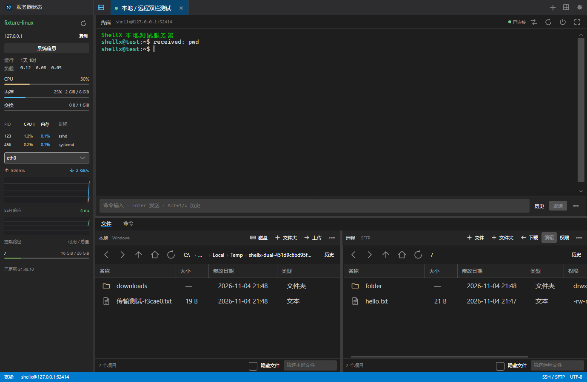
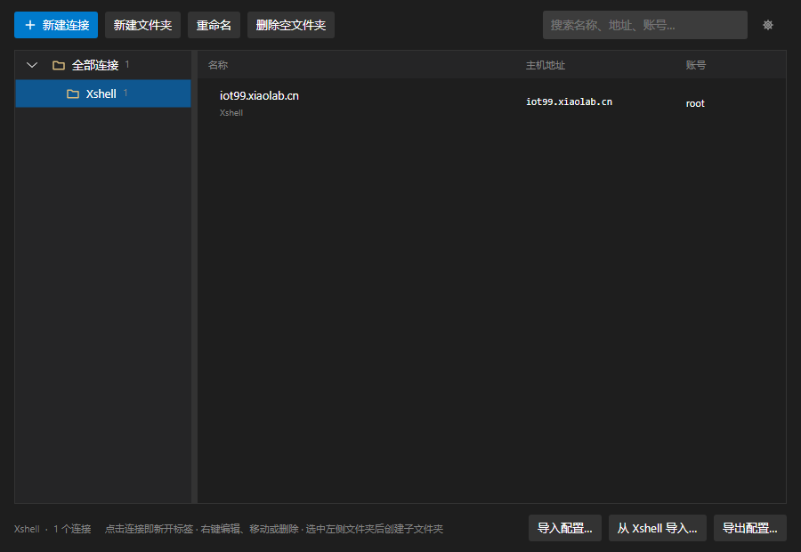
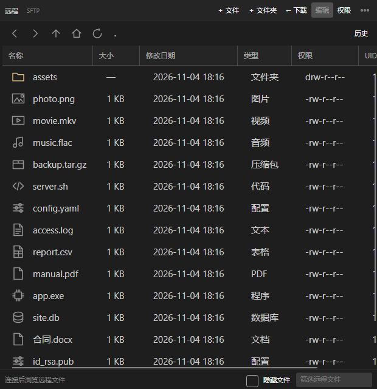
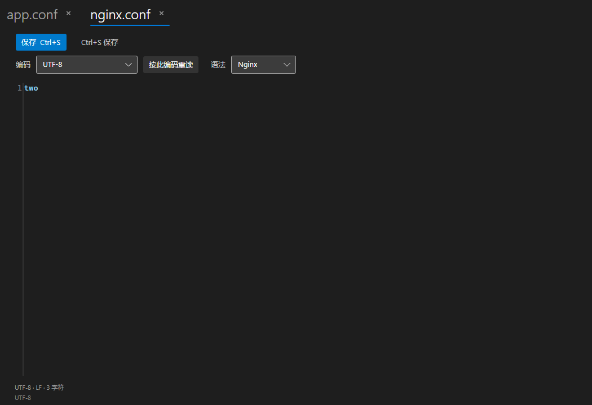
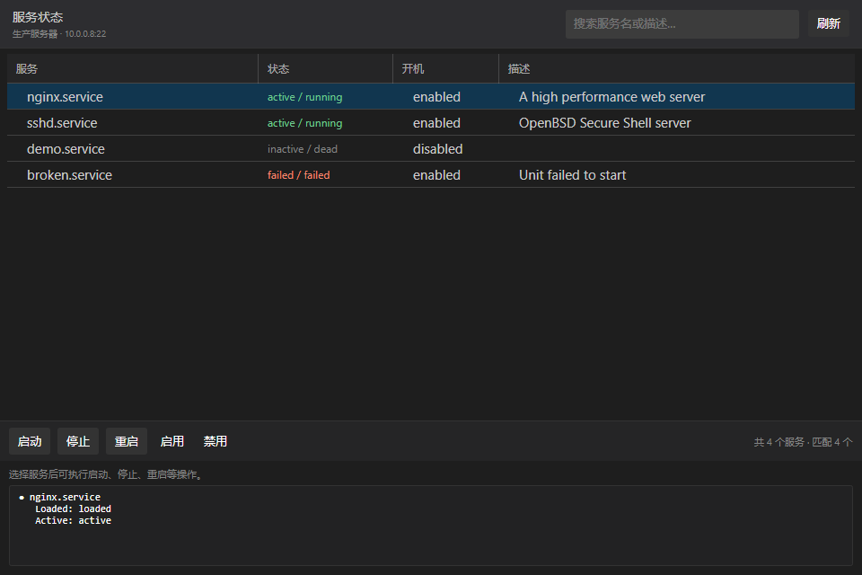

<p align="center">
  
</p>

<h1 align="center">ShellX</h1>

<p align="center">
  <b>SSH 桌面工作台 · 终端 / 文件传输 / 端口转发 / 服务器监控 / MCP</b><br />
  <sub>A Windows-first SSH workbench built with Avalonia UI and .NET 10.</sub>
</p>

<p align="center">
  <a href="https://github.com/coolqingcheng/shell-x/actions/workflows/ci.yml"></a>
  <a href="https://github.com/coolqingcheng/shell-x/releases/latest"></a>
  <a href="https://github.com/coolqingcheng/shell-x/releases"></a>
  <a href="https://dotnet.microsoft.com/download/dotnet/10.0"></a>
  <a href="https://github.com/coolqingcheng/shell-x/actions/workflows/ci.yml"></a>
  <a href="LICENSE"></a>
</p>

<p align="center">
  <a href="#特性">特性</a> ·
  <a href="#下载与安装">下载</a> ·
  <a href="#快速开始">快速开始</a> ·
  <a href="#从源码构建">构建</a> ·
  <a href="#参与贡献">参与贡献</a> ·
  <a href="#许可证">许可证</a>
</p>



ShellX 使用 **Avalonia UI + .NET 10** 构建，界面布局参考 FinalShell：左侧是服务器状态监控，上方是多标签终端，下方是本地 / 远程双栏文件面板与命令面板，各分区均可拖动调整。发布形态为 **Native AOT 单文件**，目标机器无需安装 .NET。

## 特性

| 模块 | 说明 |
| --- | --- |
| 连接管理 | 文件夹分组与搜索、多标签、连接标识色、新建 / 导入 / 导出（不含密码与私钥）、连接前测试连接 |
| 终端 | xterm-256color、快捷命令与历史、右键复制粘贴、字体缩放、断线自动重连、标签独立重命名 |
| 文件管理 | 本地与 SFTP 双栏、按类型显示线条图标、拖拽上传下载、递归目录、Unix 权限编辑、内置文本编辑器（非模态标签页） |
| 端口转发 | 本地 / 远程规则、同地址标签共享状态、TCP 连通检测、实时速度与流量动画、断线自动恢复 |
| 服务管理 | systemctl 服务列表、状态与描述、按名称或描述搜索、启动 / 停止 / 重启 / 启用 / 禁用 |
| 服务器监控 | CPU、内存、负载、进程列表、网络速率、磁盘挂载与容量（Linux `/proc`） |
| MCP 服务 | HTTP JSON-RPC 暴露本机命令执行，Bearer 鉴权、一键复制客户端配置、逐条审计日志与实时日志窗口 |
| 安全 | 服务器指纹校验（SHA-256）、Windows DPAPI 凭据保护、应用锁与超时自动锁定 |
| 发布 | Native AOT 单文件、Inno Setup 安装包、应用内自动更新（GitHub Releases） |

### 连接与终端

- 启动后先进入连接管理器，选中连接才会创建并显示主工作区窗口；`Ctrl+N` 新建连接，`Ctrl+W` 关闭标签。
- 新建 / 编辑连接时可填写主机、端口、账号、密码或私钥（默认打开用户 `.ssh` 目录），并点击**测试连接**验证凭据与指纹后再保存。
- 标签可单独重命名，不影响连接配置；同一连接可同时开多个标签。
- 快捷命令支持历史记录（`Alt+↑/↓`）与发送状态提示；终端支持右键复制选中内容、粘贴剪贴板内容。
- 断线后按设置的间隔自动重连，可在 `设置 → 常规` 关闭。

### 文件管理

- 左侧本地目录、右侧远程 SFTP 目录，双栏都支持 `F5` 刷新、`F2` 重命名、`Delete` 删除、`Alt+↑` 上级目录。
- 文件列表按扩展名显示线条图标与类型文字（图片 / 视频 / 音频 / 压缩包 / 代码 / 配置 / 表格 / 程序 / 数据库 …），工具栏为大尺寸矢量导航图标。
- 上传、下载支持多选文件与目录，也可直接从 Windows 资源管理器拖入；目录传输保留子目录、空目录和隐藏文件，合并前确认，不跟随符号链接。
- 界面按钮、文件类型与目录树图标统一为**矢量线条图标**（不使用字体图标），不同缩放下边缘一致。
- 内置文本编辑器面向日常配置文件，且为**非模态标签页**：点击“编辑文本”不会挡住窗口，再次打开其他文件会直接新增标签，同一文件重复点击则聚焦已有标签；
  读取上限 **2 MiB**、**256K** 字符、**10000** 行、单行 **8192** 字符；自动识别编码，`Ctrl+S` 保存保留原编码与 BOM，保存前比对修改时间与原始字节，避免覆盖外部改动。
- 权限对话框提供 rwx 与特殊权限位复选框及八进制数值；上传下载有任务列表、进度与取消。

### 端口转发

- 支持本地转发与远程转发；点击工具栏 `⇄` 新建或管理规则，已保存规则在连接时自动启动。
- 同一主机地址、SSH 端口和账号的标签共享隧道状态，任一标签启停都会同步；最后一个连接断开时释放监听。
- 工具栏 `⇄` 颜色反映状态：绿色连通、红色异常、黄色检测中 / 待验证、灰色停止，悬停可查看失败原因。
- 启动后立即检测目标 TCP，也可手动点击“检测”；后台每 10 秒只检查 SSH 与监听是否存活，**不会向目标反复建立空连接**。
- 隧道行有数据经过时显示流量徽标动画与实时速度（`↑ 1.5 MB/s ↓ 340 KB/s`），空闲时自动隐藏。

### 服务管理

- 入口在“端口转发”面板标题栏的 **服务** 按钮（未连接时禁用）；窗口为非模态，同一连接重复打开只会激活已有窗口，标签关闭或连接断开时窗口自动关闭。
- 列表由 `systemctl list-units` 与 `list-unit-files` 合并而来：服务名、状态、开机、描述四列，状态按 运行中（绿）/ 失败（红）/ 未运行（灰）着色，可点列头排序。
- 顶部搜索框按**服务名或描述**实时过滤；点击某一行会在下方显示 `systemctl status` 详情（描述、加载状态、主进程、内存与最近日志）。
- 选中服务后可执行 **启动 / 停止 / 重启 / 启用 / 禁用**：执行前确认，完成后把 systemctl 的原始输出、错误与退出码显示出来并自动刷新列表；非 root 账号的权限拒绝也会原样呈现。
- 服务名在本地做白名单校验后才拼进命令，杜绝注入；命令按单行下发，避免换行符被远端 shell 解释出错。

### 服务器监控

- 左侧面板展示运行时长、负载、CPU、内存、交换分区、进程列表、网络速率、磁盘挂载与容量。
- 依赖 Linux `/proc` 以及 `ps`、`df`、`hostname`；进程 CPU 取 `ps` 报告值，整体 CPU 由相邻 `/proc/stat` 样本计算。
- 指标无法读取时给出明确状态，终端与文件功能不受影响；点击进程表或内存表头可切换排序，排序在重启后保留。

### MCP 本地命令

连接编辑器中的“允许 MCP 执行本机命令”默认关闭。开启后 MCP 可在运行 ShellX 的电脑本机执行命令（不经过 SSH），并按连接记录审计日志。

```text
POST http://127.0.0.1:8765/mcp
GET  http://127.0.0.1:8765/healthz
```

地址与 Bearer Token 在 `设置 → MCP` 中，首次启动自动生成；可一键复制通用客户端 JSON：

```json
{
  "mcpServers": {
    "shellx": {
      "type": "http",
      "url": "http://127.0.0.1:8765/mcp",
      "headers": { "Authorization": "Bearer <token>" }
    }
  }
}
```

提供 `list_mcp_connections` 与 `execute_local_command` 两个工具；每次执行、拒绝和失败都写入 `%LOCALAPPDATA%\ShellX\logs\mcp-audit-yyyyMMdd.jsonl`，主页右上角“MCP 日志”可实时逐行查看。服务默认只监听 `127.0.0.1`，对外开放前请自行加上 TLS 与访问控制。

### 安全

- 首次连接要求确认服务器指纹（SHA-256），确认后记录在 `known-hosts.json`。
- 只有勾选“记住凭据”才保存密码 / 私钥口令，使用当前 Windows 用户范围的 DPAPI 加密，无法直接复制到其他用户或电脑。
- 应用锁支持锁定密码与“锁屏超过指定时长才锁定”策略；默认日志不记录终端输入输出、凭据与文件正文。
- 服务器合法更换密钥时，请先通过可信渠道核对新指纹，再删除 `known-hosts.json` 中该主机的旧记录后重新连接。

## 下载与安装

前往 [Releases](https://github.com/coolqingcheng/shell-x/releases/latest) 获取最新版本：

| 平台 | 产物 | 说明 |
| --- | --- | --- |
| Windows x64 | `ShellX-Setup-<版本>.exe` | Inno Setup 安装包，安装到 `%LOCALAPPDATA%\Programs\ShellX`（免管理员），含开始菜单与卸载入口 |
| Windows x64 | `ShellX-<版本>-win-x64.zip` | 免安装便携包，解压即可运行 |
| Linux x64 | `ShellX-<版本>-linux-x64.tar.gz` | Releases 附件，`tar -xzf` 解压后运行 `./ShellX` |
| macOS（Apple Silicon） | `ShellX-<版本>-osx-arm64.tar.gz` | Releases 附件，解压后运行 `./ShellX` |

- 系统要求：Windows 版**无需安装 .NET 运行时**；Linux / macOS 版同样为 Native AOT 单文件。
- **Linux / macOS 构建为实验性**：CI 仅验证编译与发布，尚未在真实系统完成运行验收；非 Windows 平台暂不支持保存密码（提示后仅本次连接生效），锁屏自动锁定在非 Windows 上不可用，服务器监控依赖 Linux `/proc`。
- 应用内更新：`设置 → 更新` → 检查更新 → 下载安装包 → 确认后立即更新并重启；可开启“启动时自动检查更新”。

## 快速开始

1. 下载安装包并安装（或解压便携包）。
2. 启动后在连接管理器点击 **新建连接**，填写主机、端口、账号与认证方式，用**测试连接**验证后再保存。
3. 双击连接进入工作区：左侧查看服务器状态，上方使用终端，下方管理文件与命令。
4. 需要转发端口时点击工具栏 `⇄` 添加规则，连接成功后会自动启动并检测。

常用快捷键：

| 快捷键 | 作用 |
| --- | --- |
| `Ctrl+N` / `Ctrl+W` | 新建连接 / 关闭标签 |
| `Ctrl+B` | 打开连接管理器 |
| `F5` / `F2` / `Delete` | 文件列表：刷新 / 重命名 / 删除 |
| `Alt+↑` | 文件列表：上级目录 |
| `Alt+↑` / `Alt+↓` | 命令输入框：历史 上一条 / 下一条 |

## 界面

**连接管理器** —— 文件夹分组、搜索、连接测试与配置导入导出：



**文件管理** —— 本地与远程双栏，按类型显示图标与类型列：



**文本编辑器** —— 非模态窗口，多文件标签同时打开：



**服务状态** —— 端口转发面板进入，查看与操作系统服务：



## 从源码构建

### 环境要求

| 依赖 | 用途 |
| --- | --- |
| .NET SDK 10 | 构建与运行 |
| Visual Studio MSVC x64 工具 + Windows SDK | Windows Native AOT 发布 |
| Inno Setup 6 | 构建安装包（`winget install JRSoftware.InnoSetup`） |
| Python + Paramiko | 本机 SSH 测试服务（仅集成测试需要） |

### 运行与构建

```powershell
# 开发运行
dotnet run --project src/ShellX.Desktop

# 构建 Windows x64 Native AOT 单文件（默认）
build.bat
# 产物：artifacts\release\win-x64-aot\ShellX.exe

# 直接调用底层脚本
powershell -ExecutionPolicy Bypass -File scripts/publish.ps1 -Aot
```

Linux 与 macOS 使用同一条发布命令（由 CI 在对应 runner 上执行）：

```bash
dotnet publish src/ShellX.Desktop/ShellX.Desktop.csproj \
  -c Release -r linux-x64 --self-contained true \
  -p:PublishAot=true -p:PublishSingleFile=false \
  -o artifacts/publish/linux-x64

# macOS Apple Silicon：把 -r 改为 osx-arm64
```

AOT 产物只分发一个可执行文件；Windows 版首次启动会把内嵌的原生组件释放到 `%LOCALAPPDATA%\ShellX\native\win-x64\<内容版本>\` 并在后续启动复用。XAML 与代码使用编译绑定，JSON 使用源生成，以保证 AOT 兼容。

### 一键发布

```powershell
powershell -ExecutionPolicy Bypass -File scripts/release.ps1
```

流程：`VERSION` 版本号 +1 → AOT 构建并校验产物 FileVersion → 提交推送 → 推送 `v*` 标签 → GitHub Actions 自动产出安装包、免安装压缩包并发布 Release。

常用参数：`-Version 1.1.0` 指定版本、`-Message "说明"` 指定提交信息、`-NoPush` 只本地提交、`-NoTag` 不打标签；脚本会先关闭正在运行的 ShellX 再构建。版本号唯一来源是根目录 `VERSION` 文件，编译产物、安装包与窗口标题显示的版本均取自它。

### 测试

```powershell
dotnet test ShellX.slnx
```

SSH 集成测试使用仓库内的本机服务（随机回环端口、独立文件目录，不接触真实服务器）：

```powershell
python -m pip install paramiko
python tests/fixtures/ssh_server.py artifacts/ssh-fixture

# 另一个终端
$env:SHELLX_TEST_FIXTURE = "$PWD/artifacts/ssh-fixture/fixture.json"
dotnet test ShellX.slnx
```

未配置本机服务时，网络集成测试会自动跳过。测试覆盖凭据加密、配置并发与损坏恢复、会话释放、SFTP 操作与权限、双向端口转发与监听冲突、本地与远程文件删除、终端 ANSI / 中文 / 缩放 / 多标签等。

需要界面截图用于文档或排查时：

```powershell
$env:SHELLX_PREVIEW_PATH = "$PWD\artifacts\preview\.keep"
dotnet test tests/ShellX.Desktop.Tests -c Release
```

渲染结果输出到 `artifacts\preview\`。若开发版正占用默认输出目录，可用 `--artifacts-path artifacts\isolated-build` 使用独立构建目录。

持续集成见 [ci.yml](.github/workflows/ci.yml)：Windows runner 负责编译与全量测试，Ubuntu / macOS runner 负责 Native AOT 发布并上传构建产物（便于在合并前拿到预览版）。
发布见 [release.yml](.github/workflows/release.yml)：打 `v*` 标签时并行产出 Windows 安装包 / 便携 zip、Linux 与 macOS 的 `tar.gz`，最后统一挂到同一个 Release。

### 项目结构

| 项目 | 职责 |
| --- | --- |
| `ShellX.Core` | 模型、接口、会话生命周期、路径与参数规则 |
| `ShellX.Infrastructure` | SSH.NET、SFTP、隧道、JSON 配置、Windows DPAPI |
| `ShellX.Desktop` | Avalonia、MVVM、终端控件适配、交互服务、DI 与日志组装 |

核心层不引用 SSH.NET，基础设施层不引用 Avalonia；ViewModel 只通过 Core 接口调用功能。完整设计见 [docs/architecture.md](docs/architecture.md)。

### 配置与日志

默认目录 `%LOCALAPPDATA%\ShellX`，开发与测试可用 `SHELLX_DATA_DIR` 指向独立目录。

| 文件 / 目录 | 内容 |
| --- | --- |
| `connections.json` | 连接、分组、私钥路径、隧道规则与快捷命令 |
| `settings.json` | 字体字号、锁定密码校验值、自动锁定策略、界面布局、监控排序等 |
| `known-hosts.json` | 已确认的服务器 SHA-256 指纹 |
| `credentials/` | 仅在勾选“记住凭据”时保存，由 DPAPI 保护 |
| `logs/` | Serilog 滚动日志与 MCP 审计日志 |
| `updates/` | 自动更新下载的安装包与待安装记录 |

配置损坏会明确报错并保留原文件，连接配置采用临时文件写入后替换。

## 已知限制

- Windows x64 为已验收平台；Linux x64 与 macOS（Apple Silicon）由 CI 产出，属实验性构建，尚未完成运行时验收。
- 非 Windows 平台暂不支持凭据持久化（保存时明确提示，仅本次连接生效），锁屏自动锁定依赖 Windows 会话事件。
- 内置编辑器面向中小配置文件，超出字节 / 字符 / 行数 / 单行长度限制时提示改用外部编辑器。
- 单次目录下载上限为 100000 个项目、128 层；传输目录内的符号链接会跳过，下载不写入本地符号链接。
- SFTP 不可用时终端仍可使用，可通过重新连接重试 SFTP。
- 资源监控依赖 Linux `/proc` 与常见命令；非 Linux 或无权限账号会显示明确状态。
- 验证基于本机 SSH 测试服务与真实服务器样本，详见 [docs/verification.md](docs/verification.md)。

## 参与贡献

欢迎 Issue 与 Pull Request：

1. Fork 仓库并从 `dev` 分支创建你的改动分支。
2. 保证 `dotnet build ShellX.slnx -c Release` 与 `dotnet test ShellX.slnx -c Release` 通过（网络集成测试可按上文启用本机 SSH 服务）。
3. 提交信息使用简洁的约定式写法，例如 `fix(tunnels): 修复监听冲突提示`。
4. 面向 `dev` 发起 Pull Request，说明改动动机、验证方式与影响面。

涉及用户可见行为的改动，请同步补充 [docs/verification.md](docs/verification.md) 的验证记录；正式发版统一走 `scripts/release.ps1`。

## 致谢

- [Avalonia UI](https://avaloniaui.net/) —— 跨平台 UI 框架
- [SSH.NET](https://github.com/sshnet/SSH.NET) —— SSH / SFTP / 端口转发实现
- [AvaloniaEdit](https://github.com/AvaloniaUI/Avalonia.AvaloniaEdit) —— 内置文本编辑器
- [Iciclecreek.Avalonia.Terminal](https://github.com/AvaloniaCommunity/Iciclecreek.Avalonia.Terminal) —— 终端控件
- [CommunityToolkit.Mvvm](https://learn.microsoft.com/dotnet/communitytoolkit/mvvm)、[xUnit](https://xunit.net/)、[Inno Setup](https://jrsoftware.org/isinfo.php)

## 文档

- [架构设计](docs/architecture.md)
- [验证记录与排查过程](docs/verification.md)

## 图标

应用图标为原创的“终端提示符 + 蓝色 X”设计，源稿见 `src/ShellX.Desktop/Assets/ShellX.svg`，并导出多尺寸 ICO / PNG。修改后执行 `python scripts/generate-icon.py` 重新生成（运行程序不依赖 Python）。

## 许可证

本项目采用 [MIT License](LICENSE) 开源。
